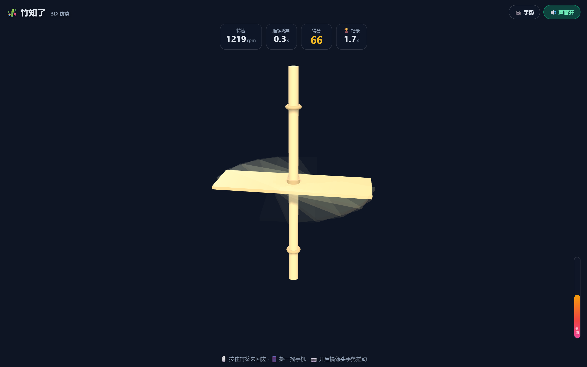

# 竹知了 · 3D 仿真游戏 🎋

> Bamboo Cicada — 一个把中国传统竹制玩具「竹知了」搬进浏览器的 3D 交互式仿真游戏。

[English](README.md) | **中文文档**

「竹知了」是一根竹签串着一片薄竹片的老玩具：用手搓动竹签，竹片高速旋转切割空气，发出类似夏天蝉鸣的「哇呜——哇呜——」声。转得越快、音调越高；转速慢下来，声音也跟着变闷变低，直到停下。

这个项目用 **Three.js + Web Audio API + MediaPipe Hands** 在浏览器里还原了这一整套体验——**无构建步骤、无后端、纯静态**，打开即玩。

<p align="center">
  
  
</p>

---

## ✨ 功能特性

- 🎋 **立体竹制质感**：竹签 + 竹片 + 竹节建模，金黄竹色材质，方向光/边缘光塑造立体感，支持鼠标拖拽旋转视角。
- 🌀 **真实旋转物理**：搓动给竹片一个角速度，之后受空气阻力（线性 + 二次阻力）自然衰减，转速越高衰减越快。
- 🔊 **Web Audio 实时合成蝉鸣**：**不使用任何预录音频**，音调与响度随转速连续变化，转速归零声音自然消失。
- 👻 **运动残影**：7 层半透明竹片副本随转速展开/收拢，直观感受「快 → 慢」。
- 🖐️ **多端交互**：鼠标拖拽 / 手机触摸 / 摇一摇（DeviceMotion）/ 摄像头手势（MediaPipe Hands）。
- 🏆 **挑战计分**：连续鸣叫时长、实时得分、最高转速与最好成绩（localStorage 持久化）。

## 🎮 玩法

1. 点击「开始玩」。
2. **搓动竹签**：桌面端按住竹片/竹签来回拖动；手机端单指搓动，或直接「摇一摇」手机；也可开启摄像头，对着镜头来回搓动手掌。
3. 竹片转起来后，听音调随转速变化；松开后转速自然衰减、蝉鸣渐弱直到停。
4. 挑战目标：**让竹知了持续鸣叫更久、冲到更高转速**，冲击你的最好纪录。

## 🛠 技术栈

| 技术 | 用途 |
| --- | --- |
| [Three.js r128](https://threejs.org/) | 3D 场景渲染、光照、阴影 |
| Web Audio API | 蝉鸣实时合成（锯齿波载波 + LFO 脉冲调制） |
| [MediaPipe Hands](https://developers.google.com/mediapipe) | 摄像头手势识别（按需加载） |
| 原生 JavaScript | 物理模拟、交互、计分（无构建工具、无框架） |

## 📐 技术细节

### 1. 旋转物理

竹片绕竹签轴旋转，状态量为角度 `θ` 与角速度 `ω`。搓动输入直接映射目标转速，松开后进入自由衰减：

```
dω/dt = -k1·ω - k2·ω·|ω|        （空气阻力：线性 + 二次）
θ += ω·dt
```

- 线性项 `k1 = 0.02`（空气黏性，低速主导）
- 二次项 `k2 = 0.012`（压力阻力，高速更明显，让满速约 8~12 秒自然停下）

搓动映射：`ω_target = 搓动速度 × 0.22`（夹在 `[0, MAX_OMEGA]`），用指数平滑逼近，保证「跟手」。

### 2. 蝉鸣合成（Web Audio）

所有声音实时合成，节点链路：

```
osc1(sawtooth, fCarrier) ─┐
osc2(sawtooth, detune+6)  ─┴→ bandpass filter → masterGain → destination
lfo(sine, fPulse) → lfoGain ─→ masterGain.gain  （幅度调制）
```

设归一化转速 `n = ω / ω_max ∈ [0,1]`，三个关键参数随 `n` 连续变化：

| 参数 | 公式 | 效果 |
| --- | --- | --- |
| 载波频率 `fCarrier` | `150 + n × 1150` Hz | 音调随转速升高（150 → 1300 Hz） |
| 脉冲频率 `fPulse` | `2.5 + n × 27` Hz | 「哇呜哇呜」节律随转速变密 |
| 总增益 `gain` | `n^1.6 × 0.34` | 响度随转速增大，转速 0 时静音 |

`fPulse` 对应真实竹知了的**叶片通过频率**——竹片每转过一圈切割一次空气，转速越高「哇呜」越密集，这也正是蝉鸣那种周期性起伏的来源。所有参数用 `setTargetAtTime` 平滑过渡，避免爆音。

### 3. 运动残影

主竹片之外，额外渲染 7 个共享几何体的半透明副本，每个副本绕轴滞后一个角度：

```
trailAngle = 0.04 + n × 0.55 rad
opacity_i  = max(0, 0.42·n - i·0.045)
```

转速高时残影沿圆周展开成扇形/圆盘；转速下降时残影收拢并淡出，露出单个竹片——让「减速」一目了然。

### 4. 摄像头手势（MediaPipe Hands）

点击「📷 手势」后动态加载 MediaPipe（模型约 10MB，走 CDN），获取单只手 21 个关键点。取掌根/指根平均作为手掌中心，计算其在水平方向的运动速度：

```
handSpeed = |dx/dt| × 2600
搓动判定：handSpeed > 阈值  →  驱动竹片旋转
```

识别结果以绿色骨架实时叠加在右下角画中画上，画中画整体 `scaleX(-1)` 做自拍镜像，保证画面与关键点对齐。

### 5. 挑战计分

- 转速 > `140 rpm` 视为「鸣叫中」，开始累计连续鸣叫时长。
- 得分 = 对归一化转速积分（鸣叫期间累加）。
- 最好成绩（最长连续鸣叫、最高转速）写入 `localStorage`，跨会话保留。

## 🤖 生成提示词（Prompt）

本项目完全由 AI 编程助手根据自然语言提示词生成。完整生成过程如下：

**① 初始需求**

> 帮我做一个 3D 版的「竹知了」传统玩具的仿真网页游戏，响应式多端兼容。

**② 细化技术方案**

> 竹知了式中国传统的竹制玩具，一根竹签上串着一片薄竹片，用手搓动竹签让竹片高速旋转，竹片切割空气产生振动，发出类似夏天蝉鸣的「哇呜——哇呜——」声。转得越快、音调越高；转速慢下来，声音也跟着变闷变低，直到停下。请先联网搜索了解竹知了的构造，发声原理和真实的声音特征，确保仿真的物理和声音尽量接近真实。核心要求：
> 1. 用 Three.js 做 3D 渲染，竹知了要有立体竹制质感，支持旋转视角观察。
> 2. 声音必须用 Web Audio API 实时合成，不允许使用任何预录音频；音调和响度跟着实时转速连续变化，转速降下来声音自然衰减消失。
> 3. 竹片旋转要有真实物理模拟：搓动给初始角速度，之后受空气阻力逐渐衰减。
> 4. 支持摄像头识别手势控制竹知了旋转（MediaPipe Hands），手掌搓动驱动竹片转动。
> 5. 同时支持鼠标拖拽、手机触摸、摇一摇等传统操作。
> 6. 画面上要能明显看出竹片在高速旋转，用运动模糊或残影效果让人直观感受转速变化。
> 7. 加一个可玩挑战玩法（连续鸣叫时长 / 最高转速），实时计分并记录最好成绩。

**③ 迭代：显示摄像头画面**

> 显示摄像头画面

**④ 开源与部署**

> 帮我部署到我的 GitHub 仓库并开源，整理开源文件，制作 README 介绍项目提示词和技术细节。

## 🚀 本地运行

纯静态，无需安装依赖：

```bash
# 方式一：直接用任意静态服务器
python -m http.server 8000        # 然后访问 http://localhost:8000

# 方式二：直接双击 index.html（也能玩）
```

> 摄像头手势需要 HTTPS 或 localhost 环境（`getUserMedia` 安全上下文要求），`file://` 或非本机 HTTP 下会不可用；其余玩法不受影响。

## 🌐 部署到 GitHub Pages

1. 把本仓库推送到 GitHub。
2. 进入仓库 **Settings → Pages**。
3. **Source** 选择 `Deploy from a branch`，分支选 `main`，目录选 `/ (root)`。
4. 保存后稍等片刻，访问 `https://<你的用户名>.github.io/<仓库名>/` 即可在线游玩。

（也可以把上面这段配置成 GitHub Actions 自动部署，本项目为纯静态站，无需构建步骤。）

## 📁 目录结构

```
.
├── index.html            # 页面结构 + 游戏 UI
├── style.css             # 响应式样式
├── app.js                # 3D / 物理 / 声音 / 交互核心逻辑
├── vendor/
│   ├── three.min.js      # Three.js r128（第三方，MIT）
│   ├── OrbitControls.js  # 相机控制（第三方，MIT）
│   └── THREE-LICENSE.md  # 第三方库许可声明
├── assets/               # README 用演示截图
├── LICENSE               # 本项目 MIT 许可
├── README.md             # 英文 README
└── README.zh-CN.md       # 中文 README（本文件）
```

## 📄 许可证

本项目采用 [MIT License](LICENSE)。

第三方库 `vendor/` 目录下的 Three.js 与 OrbitControls 版权归 [three.js authors](https://github.com/mrdoob/three.js) 所有，详见 [vendor/THREE-LICENSE.md](vendor/THREE-LICENSE.md)。
